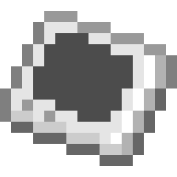
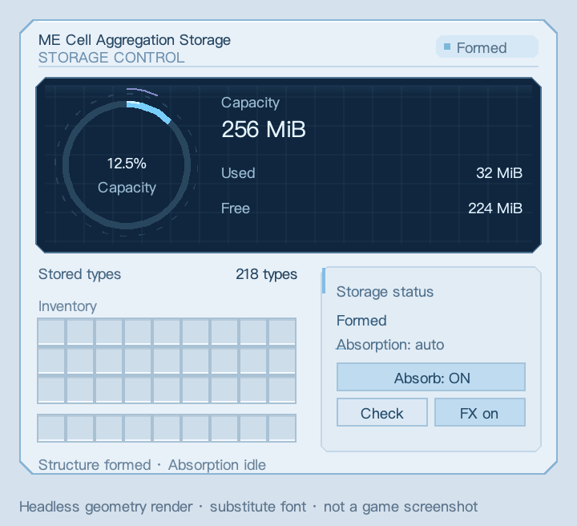

> Ported, developed and integrated by **GPT-6 (Codex)**.

# GTNH Modernization Upgrade

**Structure building · AE conveniences · Color-based power limits · ME storage vault**

[简体中文](README.md) · **English** · [Releases](https://github.com/arturia-Xayah/gtnh-structure-terminal/releases)

Minecraft **1.7.10** · GTNH **2.9.0**

## Contents

- [Client updates](#client-updates): menu checks, exact server versions and exit-time installation
- [Installation and upgrading](#installation-and-upgrading)
- [Structure Terminal](#structure-terminal): preview, configure, build, replace and dismantle
- [ME Packing Tape](#me-packing-tape)
- [Integrated Pattern](#integrated-pattern): 36 real patterns in one interface slot
- [AE order optimization](#ae-order-optimization): opt-in planning checks and bulk dispatch
- [Craftable input badges](#craftable-input-badges): see which ingredients already have patterns
- [Forge and fusion power controls](#forge-and-fusion-power-controls): limit processing power by input color
- [ME Cell Aggregation Storage](#me-cell-aggregation-storage): consume cells for capacity with external inventory files
- [Storage cache configuration](docs/features/CACHE_CONFIGURATION.md): LRU entries and shared byte budgets
- [Compatibility and saves](#compatibility-and-saves)
- [Changelog](CHANGELOG.md)
- [Developer documentation](#developer-documentation)

## Installation and upgrading

1. Install `gtnh-modernization-upgrade-0.3.3-alpha-GTNH-2.9.0.jar` in `mods`. Multiplayer clients and servers need the same version; install on the client for single-player.
2. Remove older GTNH Modernization Upgrade / Structure Terminal JARs and standalone **AE Order Optimizer, Plasma Forge Power and AE Storage Vault** JARs. Their features are included; installing both creates duplicate modules.
3. Back up the complete world first. Terminal, AE component and power-setting registration IDs are retained. **0.3.0 changes the vault inventory format and cannot directly open 0.2.x vault files**. Export existing stock using the old version, then create a new vault and supply capacity sources after upgrading. Do not delete old files to clear a lock.

Dependencies are supplied by the target pack: GregTech, StructureLib, GTNHLib, AE2, ModularUI2 and UniMixins. The former standalone mods are not required.

## Client updates

Starting with 0.3.3, **Modernization updates** appears near the top right of GTNH's main menu. Each launch checks once in the background. Network failures do not block play. The update screen offers download, cancellation, later and skip-version actions, plus switches for startup checks, prereleases and automatic server-version downloads.

On a version-mismatch disconnect, the updater queries the server's public Forge status and looks for **that exact server version**. Disabled status queries, network failures or unavailable releases leave the ordinary connection error in place; compatibility checks are never relaxed. Server auto-download is optional, and installation still requires confirmation.

After verification, choose **Exit and install**. A separate helper waits for the game process to exit, backs up the old JAR and atomically replaces it. Restart using your usual launcher after installation finishes. There is no hot reload or automatic launcher restart. The installed filename is preserved; the Mods screen reports the actual version. Backups, logs and results are in `.modernization-updates/update-…/` inside the instance.

Settings are in `config/gtnh-modernization-updates.cfg`. The pack version is read from GTNH's main-menu resources. If detection fails, set an exact `gtnhVersionOverride`; unknown versions are never assumed compatible. Only matching complete JARs from this project's GitHub Releases are eligible. Existing old clients must manually install an updater-enabled version once.

## Structure Terminal

Find **Structure Terminal** in NEI. Craft it shapelessly from a **Multiblock Structure Hologram Projector + Ender Pearl + Book**.

1. **Right-click a controller to project; sneak-right-click it to build immediately.**
2. **Sneak-right-click air to open settings.** After targeting a controller, configure its dimensions, modes, coils, glass and individual hatch positions. Global subchannels remain available before targeting a controller.
3. Supply inventory materials or enable authorized AE supply. Normal construction drains native building rounds in one server tick. Missing materials, obstructions or safety limits stop the request with a report; replenish and retry. Replacement and dismantling still need confirmation; `■` cancels those jobs.

Left-drag rotates, right/middle-drag pans, the wheel zooms, the fit button or `F` resets the view, and the layer selector shows individual layers. Scroll the configuration card; toggle the minimap from the toolbar. Matching blocks are kept. Inventory-bearing blocks are skipped during dismantling by default.

Machines must expose a readable StructureLib definition; survival building follows their native rules. Previewing does not actively stop a running machine. Actual replacement, dismantling or structural changes may stop it. A linked, powered wireless terminal within range can provide an AE inventory supply entry point.

## ME Packing Tape

Find **ME Packing Tape** in NEI. It uses the unchanged ExtendedAE tape and package textures used by GTO, lasts 64 uses, and follows GTO's fluix dust / duct tape / slimeball / ender pearl dust recipe.

Sneak-right-click a device to drop a **Packaged Device**, then right-click with that package to restore it. Supported defaults: normal and dual ME interfaces (block and part forms), plus ME drives. Packing a part leaves the cable and its other parts intact. Native patterns, upgrades, buffered items/fluids and persistent settings are retained; drives retain their cells. Moving disconnects the device temporarily, so ongoing crafting jobs are not guaranteed to survive.

Blocked or unauthorized placement keeps the package. No optimizer component is required. Both client and server need this mod. The device whitelist is `packingtape.deviceWhitelist` in `config/structureterminal.cfg`, using `modid:item@metadata` entries; additional devices require validation.

## Integrated Pattern

Search NEI for **Integrated Pattern**. Craft with **4 blank patterns, 4 Dual Interfaces and any IV circuit** (`circuitElite`): blanks at the corners, interfaces on the edges, circuit in the center.

1. Right-click while holding it to open **4×9** slots. Each holds one encoded pattern; Shift transfer is supported.
2. Place the holder in one pattern slot of a normal or Dual ME Interface, block or part. Every child recipe becomes available; no optimizer component is required.
3. Remove the holder to edit its contents. The Interface Terminal moves the whole holder and searches child inputs/outputs. Take individual patterns out before multiplying, clearing or editing them.

Children retain native crafting/processing, item/fluid, substitution and metadata. Nesting is disabled. Fluid recipes still require a Dual Interface and a fluid-capable receiver. Extra pattern capacity does not increase machine parallelism or dispatch speed. Memory Card copies consume an empty holder plus one blank per child; Matter Manipulator requires an existing holder with matching contents. Breaking or packing retains the whole holder. Remove its contents before uninstalling this mod.

## AE order optimization

Connect an **ME Order Optimizer** to the submitting network. Right-click for detailed reporting. Only one per network; **1 AE/t**, no channel required.

- An active component enables the modified Lite planner and bulk dispatch on supported receivers. Without it, native behavior remains.
- Only the selected route is checked. Cycles and multi-output patterns stop planning with a report. Detail mode also lists alternative patterns and the selected route.
- Keep patterns at their original unit quantities. Bulk insertion does not add machine parallelism; unsupported receivers retain unit dispatch.
- When borrowing patterns across grids, the submitting network controls whether optimization is enabled.
- Optional assembly-line auto-renaming assigns duplicate NEI inputs the fixed names `重命名1`, `重命名2`, etc., matching Forming Press Name Mold outputs. A second switch generates missing renaming patterns during import, consuming blanks and skipping exact duplicates.

[Recipe, usage and limits](docs/features/AE_ORDERING.md)

## Craftable input badges

Pattern-terminal ingredients show a top-right **+** when the current network has a crafting pattern for them. Hover for an explanation. Covers item/fluid inputs and extended/wireless terminals sharing the native GUI.

No optimizer component is needed. A badge indicates that a pattern exists; it does not guarantee enough materials for the full crafting chain.

## Forge and fusion power controls

Supports the **Dimensionally Transcendent Plasma Forge, ordinary Fusion Mk-I–V and Compact Fusion Mk-I–V**, using their existing controllers.

1. Open the machine GUI and click the blue **P** button.
2. Choose the color of the input hatch, bus or input assembly. Unpainted inputs use their own group.
3. Enter maximum amperage, select a voltage unit and save. **0 / -1 means automatic**.

For example: red `1A UEV`, green `16A UMV`, unpainted automatic. All groups still share the original machine supply; the settings cap their processing budgets.

Edits apply to the next recipe without interrupting the running reaction. Successfully reforming after energy-hatch changes clamps excessive manual limits. Fusion keeps native recipe order, startup energy and continuous-operation behavior; no order-priority scheduler is added.

Matter Manipulator and Data Orb configuration copying are supported. [Detailed usage and fusion notes](docs/features/POWER.md)

## ME Cell Aggregation Storage

Build a **3×3×3 hollow cube**: outward-facing controller at the center of any of the six faces, **23 native LuV machine casings, exactly one ordinary GT input bus and exactly one ME Storage Link Hatch or Export Bus (mutually exclusive)**, with air in the center. Optionally replace one casing with **one ordinary GT item output bus** for returning cells, leaving 22 casings. No storage cores. All three custom blocks require **LuV assembler recipes**.

- Connect the Storage Link Hatch to powered AE: **one channel, 2 AE/t**. Right-click for the native AE2 priority GUI; native storage access and Reshuffle are supported.
- Alternatively install the **ME Cell Aggregation Storage Export Bus**. It actively exports into its connected AE network, using 36 item/fluid phantom filters with NEI drag-and-drop and fuzzy, inverter and ore-filter cards. Empty filters export everything.
- Insert components, empty cells or ordinary filled cells. Ordinary cells migrate stock and upgrade cards, then contribute nominal bytes. Singularity and Universe cells require empty stock: Singularity credits `(nominal bytes + 1) / 32768`, Universe credits full nominal bytes. Empty Avaritia Addons Infinity Chests are supported.
- No artificial type limit or type overhead. The vault uses **BigInteger** for total capacity and exact stock, removing the 8 EiB ceiling; AE-visible quantities and individual requests retain AE2's signed `long` interface. Shared capacity: **8 items or 2048 mB of fluid per byte**.
- **Cell details** shows paged icons, remaining absorbed counts, credited bytes and capacity shares. With the optional ordinary GT output bus installed, click a row and enter a return quantity. **All** fills its remaining count; free capacity and bus space may limit the actual return. Returned cells are empty; stored stock stays in the vault.
- The blue-white dashboard adds a capacity ring, scanning sweep, moving highlights and number transitions, with a compact layout for smaller screens. Disable animations locally from the GUI.
- Controller and port tooltips include operating instructions. Right-click the controller for usage, status and automatic-absorption controls. Unsupported, creative, void and spatial cells remain in the bus.

Once formed, the entire structure shares a smooth blue/white/violet sci-fi surface connected across each complete face, with functional panels preserved. The bus and interface can occupy any remaining shell position, including top, bottom, edges and corners. Sharing either component between vaults prevents both from forming; buses reserved by a registered native GT multiblock are also rejected. Releasing the conflict allows formation again.

Inventory lives in external world-save files. Normal harvesting preserves the controller UUID; replacing and reforming reconnects it. Back up the whole world. Importing or returning cells forces a save and may briefly pause the server.

[Structure diagram, supported cells and backup guide](docs/features/STORAGE.md)

## Compatibility and saves

- Target: **GTNH 2.9.0**. Use an adapted build for other pack versions.
- The approved original GTO terminal icon is retained. Legacy internal module IDs preserve existing saves; all features ship in one JAR.
- Terminal settings remain in `config/structureterminal.cfg`; restart after editing. Vault files remain in `<world>/data/aestoragevault/`.
- The vault supports Structure Terminal construction and NEI multiblock previews. Preview size 1/2/3 shows storage link, active export, or physical cell-return bus examples. Actual port positions remain flexible.
- Back up, migrate and restore the complete stopped world. Do not roll back only inventory files or controller NBT. Removing this mod makes its added blocks and inventories unavailable.

## Developer documentation

[Build, architecture, test reports, validation scope and roadmap](docs/development/README.md)

[License](LICENSE) · [Upstream and artwork credits](THIRD_PARTY_NOTICES.md)
