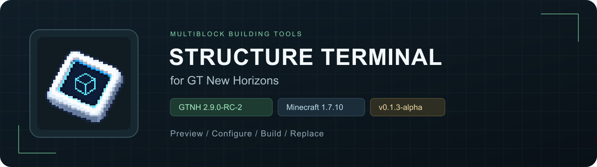

> 本 Mod 由 **GPT-6（Codex）** 实现移植与开发。

**简体中文** · [English](README.en.md)

把 GTO 结构终端的交互方式带到 GTNH。 在一个界面中预览多方块、配置材料，并完成生存搭建、替换与拆除。

[**下载 Mod**](https://github.com/arturia-Xayah/gtnh-structure-terminal/releases/tag/v0.1.4-alpha-GTNH-2.9.0-RC-2) · [快速上手](#快速上手) · [兼容性](#兼容性) · [构建与开发](docs/BUILDING.md)

---

## 功能

| | 可以做什么 |
|---|---|
| **结构预览** | 旋转、平移、缩放、分层显示，点击预览中的方块选择部件 |
| **部件配置** | 设置机器公开的尺寸、模式、线圈、玻璃等子信道；按组选择外壳，按位置选择仓室 |
| **生存搭建** | 从背包供料，调用原机搭建规则；保留符合要求的已有方块，缺料时停止，补料后可继续 |
| **替换与回收** | 替换普通结构材料并补建，或拆除并回收；已符合目标的方块不重复扣料 |
| **AE 下单元件** | 接入网络后启用路径校验与详细选路报告，支持单份样板批量派发；未接入时保留原版逻辑 |
| **AE 库存** | 可选读取已绑定无线终端对应网络中的现有材料，不发起自动合成；实际网络取料尚待验证 |

## 安装

| 项目 | 对应版本 |
|---|---|
| GTNH | **2.9.0-RC-2** |
| Minecraft / Forge | 1.7.10 / 10.13.4.1614 |
| StructureLib / GTNHLib | 1.4.45 / 0.11.52 |
| AE2 / UniMixins | rv3-beta-1080-GTNH / 整合包自带 |
| Structure Terminal | 0.1.4-alpha |

1. 从 [Releases](https://github.com/arturia-Xayah/gtnh-structure-terminal/releases/tag/v0.1.4-alpha-GTNH-2.9.0-RC-2) 下载 `structureterminal-0.1.4-alpha-GTNH-2.9.0-RC-2.jar`。
2. 放入 GTNH 实例的 `mods` 目录，客户端与服务端均需安装；单人游戏只需安装到客户端。
3. 移除旧版结构终端及独立 `aeorderoptimizer` JAR，再启动实例。合并包已包含两个功能，保留原有注册 ID。

普通玩家只需下载 JAR。源码与构建脚本保留在本仓库。

## 快速上手

**取得终端**：物品名为“结构终端”，位于创造模式的工具标签页，使用蓝白外壳与青色立方体屏幕图标。注册名为 `structureterminal:structure_terminal`。

**当前配方**：多方块结构投影仪 + 末影珍珠 + 书，无序合成。

1. **打开**：手持终端，右键已放置的多方块控制器。
2. **配置**：在右侧调整尺寸 / 模式与子信道，选择线圈、玻璃或外壳。仓室请点击预览中的具体位置选择，避免把整组位置都指定为同一种仓室。
3. **备料**：把材料放入背包；选择 AE 库存时，还需携带已绑定、已供电且在范围内的无线终端，并拥有网络取出权限。
4. **执行**：点击“投影”查看世界提示，或选择“搭建 / 替换并补建 / 拆除”。替换和拆除需要再次点击确认；“停止任务”可取消当前任务。

### 视图操作

| 操作 | 效果 |
|---|---|
| 左键拖动 | 旋转结构 |
| 右键 / 中键拖动 | 平移视图 |
| 滚轮 | 缩放；指向右侧长列表时滚动内容 |
| 点击方块 | 选择该位置的部件 |
| `F` 按钮 | 适配视图 |
| 显示层 | 切换整机或单层预览 |

## AE 下单优化（新增）

合并版内置 **ME 下单优化元件**（`aeorderoptimizer:core`）。它是接入 AE 网络的独立方块，右键打开详细模式设置；与结构终端预览界面分别使用。

- 每个网络最多一个有效元件，耗电 1 AE/t，不占频道；合网时额外元件断开并显示冲突。
- 以下单网络是否有有效元件为准；没有元件时保持原版普通 / Lite 选择与派发。
- 保留 Lite 原本选路；当前选定图遇到循环或多输出就中止并打印问题。详细模式报告候选及最终选择。
- 原生 ME 接口可按实际库存和接收能力批量投料；允许 4096 份批次时，10,000 份可分为 4096＋4096＋1808，计三次派发操作。工作台和未适配接收器保留逐份逻辑。

[使用方法、配方与限制](docs/AE_ORDER_OPTIMIZER.md) · [星门计算速度对比](docs/AE_BENCHMARK.md)。简化星门场景实测 Lite 9.36 ms、本模块 10.00 ms；未证明计算快于 Lite。路径检查目前先展开候选图再扣库存，可能检查已备足材料的上游配方。

## 兼容性

- **机器接口**：预览需要控制器提供可读取的 StructureLib 结构；生存搭建需要原机实现相应接口。仓室数量、朝向、电压和特殊材料仍遵循机器自身规则。
- **已有结构**：补建会保留符合目标的方块。替换和默认拆除跳过 TileEntity，包括仓室、容器等；只处理可识别的结构材料。
- **运行中的机器**：普通预览和 Shift 右键打开预览，不主动强制重检或改变实际朝向。替换、拆除或改变朝向会实际影响结构，可能导致机器停止。
- **界面与模型**：当前使用方块图标构建立方体预览；复杂模型、结构树、挂载机器导航和 AE 样板编码等功能尚未提供。
- **验证范围**：已进行后台结构操作测试；真实运行配方、客户端 GUI 和实际 AE 网络取料尚待验证。特殊机器及具体失败原因可查逐台结果。

[**兼容性明细**](COMPATIBILITY.md) · [**逐台测试结果**](verification/machine-coverage.csv) · [验证记录](VERIFICATION.md)

## 配置

配置文件：`config/structureterminal.cfg`，修改后重启实例。

| 配置 | 默认值 | 用途 |
|---|---:|---|
| `limits.maxPreviewCells` | 100000 | 扫描位置上限 |
| `limits.maxScanMillis` | 500 | 扫描时间预算，单位毫秒 |
| `limits.placementBudget` | 25 | 每轮请求原生搭建器放置的数量 |
| `limits.controllerReach` | 8 | 玩家与控制器的最大操作距离 |
| `features.allowDemolition` | true | 启用确认后的拆除 |
| `features.allowTileEntityDemolition` | false | 保持关闭时，拆除跳过全部 TileEntity |

每 6 个服务端 tick 执行一轮搭建，最多同时执行 4 个任务。大结构若触发扫描上限，可根据服务器情况调整预算。更多参数与测试方法见[开发文档](docs/BUILDING.md)。

## 项目资料

[构建与开发](docs/BUILDING.md) · [后台测试方法](verification/PACK_TESTING.md) · [运行状态与结构检查](STATE_CHECKS.md)

界面参考 GTO 结构终端；游戏图标与页头使用参考 GTO 终端轮廓设计的蓝白科技风贴图。代码与素材的许可、来源和上游信息见 [LICENSE](LICENSE)、[THIRD_PARTY_NOTICES.md](THIRD_PARTY_NOTICES.md) 与 [LICENSES](LICENSES)。
