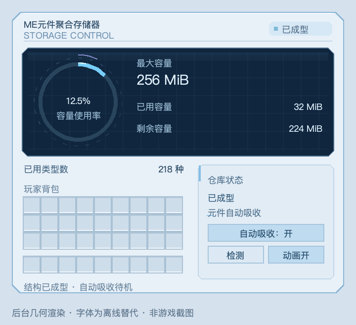

> 本 Mod 由 **GPT-6（Codex）** 实现移植、开发与整合。

# GTNH现代化升级

**结构搭建 · AE 便利功能 · 分色功率控制 · ME元件聚合存储器**

**简体中文** · [English](README.en.md) · [版本下载](https://github.com/arturia-Xayah/gtnh-structure-terminal/releases)

Minecraft **1.7.10** · GTNH **2.9.0**

## 目录

- [安装与旧版升级](#安装与旧版升级)
- [客户端更新](#客户端更新)：主菜单检查、服务器版本匹配与退出安装
- [结构终端](#结构终端)：预览、配置、搭建、替换与拆除
- [AE 下单优化](#ae-下单优化)：按网络启用计算检查和批量发配
- [样板原料＋标记](#样板原料标记)：查看原料是否已有合成样板
- [锻炉与聚变功率控制](#锻炉与聚变功率控制)：按输入颜色设置功率预算
- [ME元件聚合存储器](#me元件聚合存储器)：吸收存储元件扩容，库存保存在外部文件
- [读取缓存配置](docs/features/CACHE_CONFIGURATION.md)：LRU 条数与共享字节预算
- [兼容性与存档](#兼容性与存档)
- [更新日志](CHANGELOG.md)
- [开发者文档](#开发者文档)

## 安装与旧版升级

1. 获取 `gtnh-modernization-upgrade-0.3.0-alpha-GTNH-2.9.0.jar`，放入实例的 `mods`。联机时客户端与服务器安装相同版本；单人游戏只需安装在客户端。
2. 移除旧版 **GTNH现代化升级 / 结构终端**，以及独立的 **AE Order Optimizer、Plasma Forge Power、AE Storage Vault** JAR。以上功能已包含在整合版中，不能重复安装。
3. 升级前备份整个世界。终端、AE 元件和功率设置保留原注册 ID。**0.3.0 更改了聚合器库存格式，不能直接读取 0.2.x 的仓库文件**；已有聚合器需先在旧版导出库存，升级后新建仓库并重新投入容量来源。不要删除旧文件来解除锁定。

依赖使用目标整合包自带的 GregTech、StructureLib、GTNHLib、AE2、ModularUI2 和 UniMixins。无需另外安装原来的独立 Mod。

## 客户端更新

从 0.3.2 起，GTNH 主菜单右上方会有 **现代化升级 · 更新** 入口。每次启动在后台检查一次，网络失败不影响游戏；发现兼容版本时入口会显示提示。更新中心支持下载、取消、稍后和跳过此版本，并可开关启动检查、测试版本和服务器自动下载。

联机版本不匹配时，会尝试读取服务器公开的 Forge 状态，提供**服务器使用的确切版本**。服务器关闭状态查询、网络不通或对应版本未发布时，保留原来的连接错误，不放宽版本校验。开启“服务器自动下载”后会自动下载匹配的新版本，安装仍由你点击确认。

下载校验完成后，点击 **退出并安装**。助手等待游戏进程完全结束，备份旧包并原子替换；随后通过原启动器重新启动。不会在运行中热更新，也不会自动重启启动器。安装保持原 JAR 文件名，实际版本以 Mod 列表为准；旧包、安装日志和结果保存在实例目录 `.modernization-updates/update-…/`，请等待安装结束再启动。

设置文件为 `config/gtnh-modernization-updates.cfg`。默认读取 GTNH 主菜单的版本信息；无法识别时不会猜测兼容性，可在文件中填写准确的 `gtnhVersionOverride`。更新器只下载本项目 GitHub Releases 中适配当前 GTNH 的完整 JAR，不从服务器指定的任意网址下载。已有旧版需先手动安装一次含更新器的版本。

## 结构终端

在 NEI 搜索 **结构终端**。配方为：**多方块结构全息投影仪 + 末影珍珠 + 书**，无序合成。

1. 手持终端，**右键多方块主机投影**；**Shift＋右键主机立即搭建**。
2. **Shift＋右键空气打开设置**。右键过主机后显示该机器的预览，可调整公开的尺寸、模式、线圈、玻璃及其他部件；点击具体位置选择仓室。未选主机时也可设置通用子信道。
3. 背包备齐材料，或启用已授权的 AE 库存取料。正常搭建在一次服务端 tick 内执行到完成；缺料、障碍或安全上限会停止并报告，补齐后再次使用即可。替换、拆除仍在界面中确认，`■` 可停止这两种任务。

左键拖动旋转，右键或中键拖动平移，滚轮缩放；适配按钮或 `F` 重置视图，层选择器切换分层显示。配置卡可滚动，工具栏可开关缩略图。符合要求的已有方块会保留。默认不拆仓室、容器等带库存的方块。

支持提供可读取 StructureLib 定义的机器；生存搭建遵守原机规则。预览不会主动停止正在运行的机器，实际替换、拆除或改变结构则可能导致停机。可携带已绑定、有电且在范围内的无线终端作为 AE 库存取料入口。

## AE 下单优化

将 **ME 下单优化元件** 接入需要下单的 AE 网络，右键打开设置，可选择开启详细报告。每个网络最多一个，待机消耗 **1 AE/t**，不占频道。

- 有有效元件时启用优化后的 Lite 计算和支持接收端上的批量发配；没有元件时使用原版行为。
- 只检查当前选择的合成路线。遇到循环或多输出样板会停止并报告问题；详细模式还会说明同产物的候选配方及最终选择。
- 样板保持原始单份数量。批量投料不会增加机器本身的并行能力，未支持的接收端沿用逐份发配。
- 子网借用其他网络样板时，以下单网络是否有元件为准。

[元件配方、使用方法与限制](docs/features/AE_ORDERING.md)

## 样板原料标记

在样板终端编写配方时，原料若在当前网络中已有合成样板，其右上角显示 **＋**；悬停可查看说明。支持物品、流体及共用原生界面的扩展、无线样板终端。

不需要下单优化元件。有标记表示存在样板，不代表整条合成链一定有足够材料。

## 锻炉与聚变功率控制

支持 **超维度等离子锻炉、普通聚变 Mk-I～Mk-V、压缩聚变 Mk-I～Mk-V**，无需更换原主机。

1. 打开机器原生界面，点击蓝色 **P** 按钮。
2. 选择输入仓、输入总线或输入总成的颜色；未染色使用“无色”组。
3. 输入最大 A 数，选择电压单位，然后保存。**0 / -1 为自动**。

例如：红色输入设为 `1A UEV`，绿色输入设为 `16A UMV`，无色组设为自动。它们仍共用原机器供电，只限制各组运行配方时可使用的功率。

设置从下一轮配方生效，不打断当前反应。更换能源仓并成功成型后，超限手动设置会自动下调。聚变保留原版选配方顺序、启动能量和连续运行机制；不会自动优先下单配方。

支持物质操纵者及数据宝珠复制功率设置。[详细操作与聚变说明](docs/features/POWER.md)

## ME元件聚合存储器

建造 **3×3×3 空心结构**：主机在任意一个面的中央并朝外，支持六个朝向；其余外壳使用 **23 个原生 LuV 机器外壳、1 个标准 GT 输入总线、1 个 ME 存储链接仓或输出总线（两者互斥）**，内部中央留空。无需存储核心。可额外用 **1 个普通 GT 物品输出总线**替换外壳，用于退回元件；此时外壳为 22 个。主机、ME 存储链接仓与 ME 输出总线通过 **LuV 组装机配方**制作。

- 存储链接仓连接有电的 AE 网络，使用 **1 个频道、2 AE/t**。右键使用 AE2 原生优先级界面，支持原生存取与 Reshuffle。
- 可替换为 **ME元件聚合存储器输出总线**，主动向所连接的 AE 网络输出库存；36 格物品／流体标记支持 NEI 拖入、模糊卡、反相卡与矿物词典筛选卡。没有标记时输出全部。
- 输入总线可放空元件、存储组件或非空存储元件。普通元件迁移库存与升级卡后增加标称容量；数字奇点与人造宇宙元件仅接收空库存，奇点贡献 `(原容量 + 1) / 32768`，人造宇宙贡献完整原容量。支持空的 Avaritia Addons 无尽箱子。
- 无人为物品类型上限，无类型字节开销。总容量与每种实际库存数量均采用 **BigInteger**；AE 可见数量和单次请求仍受原生 long 接口限制。物品和流体共用容量：**8 个物品 / 2048 mB 流体占 1 字节**。
- **元件明细**分页显示图标、当前吸收数量、贡献字节和占比。安装可选普通 GT 输出总线后，点击条目输入退回数量；**全部**填入该类型的剩余数量，实际按空闲容量与总线空间部分退回。退回空元件，已有库存保留。
- 主机采用蓝白全息界面，包含环形容量仪表、扫描线、流光和数值过渡；小窗口自动切换紧凑布局。动画可在界面内关闭，设置仅保存在本地客户端。
- 主机与两个端口的物品提示提供操作说明。右键主机查看容量、类型和结构状态，也可暂停自动吸收。未知通道、创造、虚空及空间元件会留在总线中。

成型后，外壳、主机、ME 接口与总线统一为平滑蓝白紫色科幻机身，按整个面连续拼接，保留功能面板和端口标识。总线与接口可放在其余任意外壳位置，包括顶面、底面、棱边与角落，但不可被多座仓库共用；总线也不可兼用于其他已登记的 GT 多方块。冲突解除后可重新成型。

实际库存保存在世界目录的独立文件中。普通拆机保留主机 UUID，重新放置并成型后恢复访问。备份必须包含整个世界目录；吸收或退回元件时会同步存档，可能短暂停顿。

[建造示意、元件范围与备份指引](docs/features/STORAGE.md)

## 兼容性与存档

- 当前目标为 **GTNH 2.9.0**；其他整合包版本请使用对应适配版。
- 沿用原来的蓝白终端图标。历史内部模块 ID 保留，用于识别旧存档；所有功能来自同一个 JAR。
- 结构终端配置仍在 `config/structureterminal.cfg`，调整后重启。仓库仍使用 `<世界目录>/data/aestoragevault/`。
- 聚合器支持结构终端搭建与 NEI 多方块预览。预览尺寸 1／2／3 分别展示链接仓、主动输出、带普通退回总线的示例；仓室实际位置仍可自由选择。
- 请在停服时整体备份、迁移或恢复世界，勿单独回滚库存文件或主机 NBT。移除整合 Mod 后，其新增方块和库存将无法正常访问。

## 开发者文档

[构建、架构、测试报告、验证边界与开发计划](docs/development/README.md)

[许可证](LICENSE) · [上游与素材鸣谢](THIRD_PARTY_NOTICES.md)
